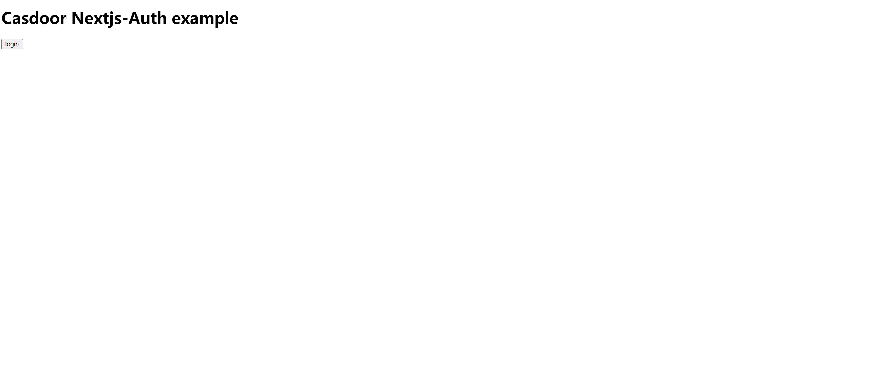

nextjs-auth
=======

A Next.js example for Casdoor SSO.

Live demo: https://nextjs-auth.casdoor.org

## Demo video



## How it works

Everything that has to do with the login runs on the server, the browser only gets httpOnly cookies:

1. `/login` creates a random `state` and a PKCE verifier, keeps them in a short-lived httpOnly cookie and redirects to Casdoor.
2. `/callback` checks that the `state` is the one of this browser, exchanges the code for an access token on the server (with the PKCE verifier, so no client secret is needed), verifies the token's signature with the [JWKS](https://door.casdoor.com/.well-known/jwks) of Casdoor and keeps the token in httpOnly cookies as the session.
3. [proxy.js](proxy.js) protects `/profile`: it verifies the signature, issuer, audience and expiry of the token on every request, so a cookie made up in the browser does not get in.
4. `/profile` shows the user from Casdoor's `/api/userinfo`.
5. `/logout` (POST) deletes the session cookies.

There is no session secret or session store, the session is the token Casdoor signed.

## Configuration

[app/conf.js](app/conf.js) points to the Casdoor demo site by default. Use your own Casdoor with environment variables (e.g. in `.env.local`):

```bash
CASDOOR_SERVER_URL=https://door.casdoor.com
CASDOOR_CLIENT_ID=294b09fbc17f95daf2fe
# optional, only for applications that require the client secret
CASDOOR_CLIENT_SECRET=
# optional, the "iss" of the tokens if Casdoor is configured with another origin
CASDOOR_ISSUER=
```

Add `http://localhost:3000/callback` (and the callback URL of your deployment) to the `Redirect URLs` of the Casdoor application.

## Getting started

Run the development server:

```bash
yarn dev
```

Open [http://localhost:3000](http://localhost:3000) with your browser to see the result.
